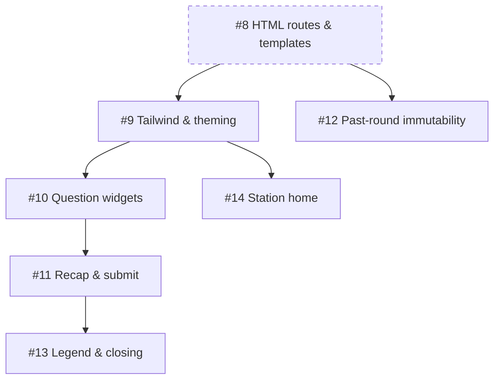

# EPIC 2 — HTTP Server & UI

## Scope

Everything browser-facing: server-rendered HTML routes, Tailwind build pipeline and theming, question screen widgets, recap/submit flow, past-round immutable rendering, legend/closing screen, and station home. This EPIC delivers the complete human-facing UI that the user interacts with to answer grill questions.

## Issues

| Issue | Title | Depends on |
|-------|-------|------------|
| #8 | Server-rendered HTML routes & templates | #1, #2, #3, #7 (#16) |
| #9 | Tailwind build pipeline & theming | #8 |
| #10 | Question screen widgets | #3, #8, #9 |
| #11 | Round recap & submit flow | #3, #5 (#16), #8, #10 |
| #12 | Past-round immutable rendering | #1 (#16), #8 |
| #13 | Legend & closing screen | #3, #5 (#16), #8, #11 |
| #14 | Station home route | #1 (#16), #8, #9 |

## Dependency graph

## Execution order

1. **Issue #8** (after #16 issues #1, #2, #3, #7): HTML routes and stdlib templates — the rendering foundation for all UI.
2. **Issue #9** (after #8): Tailwind build pipeline, dark/light mode, CSS committed to repo.
3. **Issues #10, #12, #14** (after #8, #9 — partially parallel):
   - Issue #10 (question widgets) after #3, #8, #9.
   - Issue #12 (immutability) after #8 — can proceed in parallel with #10.
   - Issue #14 (station home) after #8, #9 — can proceed in parallel with #10.
4. **Issue #11** (after #3, #5, #8, #10): recap/submit flow — depends on `grill_round` (#16 issue #5) for the unblock mechanism and on question widgets (issue #10) for the answer data shape.
5. **Issue #13** (after #3, #5, #8, #11): legend/closing screen — final screen in the user flow.

## Cross-EPIC dependencies

- **Issue #8 depends on #16 issues #1, #2, #3, #7**: routes render from state (#1, #2), use the JSON schema (#3), and are served by the daemon (#7).
- **Issue #11 depends on #16 issue #5**: the submit endpoint unblocks `grill_round` and returns answers to the agent.
- **Issue #13 depends on #16 issue #5**: the legend is delivered via a final `grill_round` call with a legend payload.

## Key decisions

- Server-rendered HTML with stdlib `html/template`; vanilla JS progressive enhancement only (no SPA framework).
- Markdown blobs rendered server-side to HTML at render time.
- Tailwind as build-time asset (vendored standalone CLI, generated CSS committed); zero Go CSS dependencies.
- Dark/light mode via class toggle, persisted in localStorage per browser.
- Widgets: exclusive radio choice (no prefill), multi-comment add/remove, "Other" requires comment, debounced autosave with "Saved!" indicator.
- Past rounds immutable by construction (server omits widgets, not client-side disable).
- Station home (`/`) owns global context: pending sessions, history, dismiss.
- No planned-round placeholders anywhere (frontier is answer-dependent).
